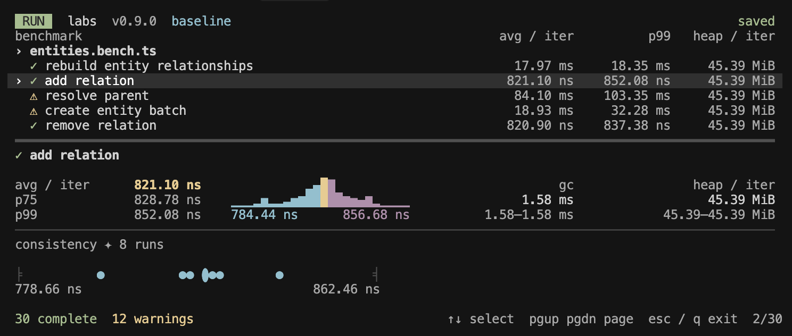
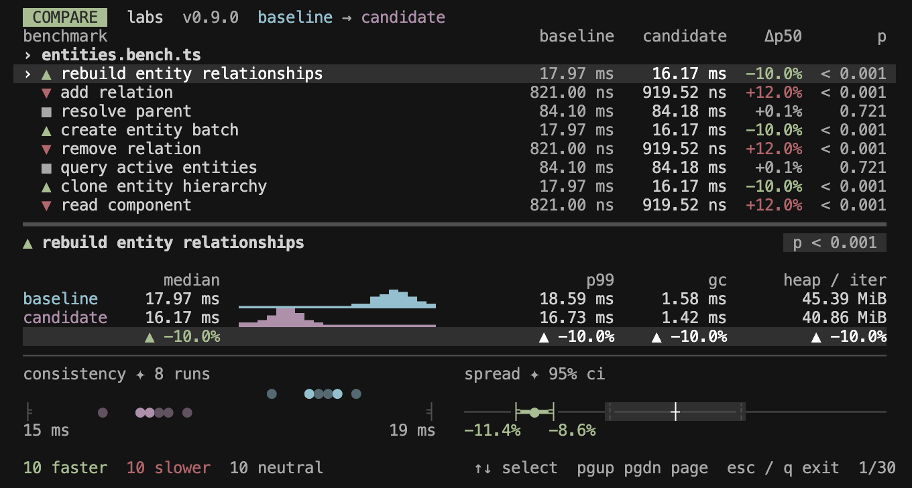

# Labs

> [!WARNING]
> Labs currently only supports Node.js. Workers are spawned via `tsx` with V8-specific flags (`--allow-natives-syntax`, `--expose-gc`), which are not portable to Bun (JSC) or Deno. Portability will be on the roadmap.

Labs is JS benchmarking you can trust. Trying to get good signal is harder than you might think. VMs are non-deterministic, environments are unstable, and typical benchmarks don't give you any sense of a comparison's validity. Labs detects variance, giving feedback on how to fix it, and uses statistical analysis to determine if two runs are actually different.

```bash
npm i @pmndrs/labs
```

### Write

Create a config and a bench file. Benches use a generator where code before `yield` is setup, the yielded function is measured, and code after is teardown.

```ts
// labs.config.ts
import { defineConfig } from '@pmndrs/labs'

export default defineConfig({
  benchDir: '.',
})
```

Use `@tags` in the name string for filtering.

```ts
// array-push.bench.ts
import { bench, group } from '@pmndrs/labs'

group('array @stress', () => {
  bench('push 1k', function* () {
    const arr: number[] = []
    yield () => {
      for (let i = 0; i < 1000; i++) arr.push(i)
    }
  })
})
```

### Run

Run your benchmarks with the `bench` command.

```sh
# Run all benches, save named after the current commit
bench
# Or filter by tag
bench "@mytag"
# Save with a name for easier reading
bench "@mytag" -n 'v1.0.0'
```

In an interactive terminal, a live view shows each benchmark's progress while it runs, then a full-screen results view opens. Select a benchmark to inspect its timings, sample distribution, memory use, and run consistency. Quitting prints a short summary. Reopen saved results with `bench list`.



<details>
<summary>How to read the results</summary>

- **⚠ UNSTABLE**: The CPU speed probes taken during the run varied more than 5%, usually from background load, efficiency cores, or throttling. Treat comparisons with other runs carefully.
- **✓, ⚠, ✗**: A warning shows one line with the most serious problem and what to do. `likely optimized out` means the work was removed by the JIT. `results change between runs` means warmup never settled or the output differed between fresh processes. `min detectable change ±N%` is the smallest change a comparison could detect, shown when it is larger than `minDelta`.
- **avg, p75, p99**: Average time per iteration and the 75th and 99th percentiles. For batched work, percentiles describe batch averages rather than individual calls.
- **Histogram**: The fastest 99% of timing samples, with the minimum and upper cutoff below. Cyan marks samples below the average, yellow the average bin, and magenta samples above it.
- **gc**: Observed GC time per iteration and its share of sampling time, including gaps between calls. Below is average GC event frequency. The share is not an exact GC contribution to `avg`.
- **gc max**: Longest observed GC event, marked `major` when applicable. Below is the number of major GC events observed.
- **heap**: Median and range of estimated bytes allocated per iteration, including typed array storage. Measured after timing; collections during diagnostics can lower the estimate.
- **consistency**: Each dot represents a fresh process's median time. Larger dots represent multiple runs at the same plotted position. Tight clusters show agreement between runs, while a wider spread shows more variation.

GC figures exclude warmup and heap diagnostics and do not capture all GC overhead. Disable observation with `.gc(false)`. Set `heap: false` in `labs.config.ts` to skip heap diagnostics and their forced collections while keeping GC observation during timing.

</details>

### Compare

Compare against a baseline.

```sh
bench compare
```

Browse the results in a full-screen comparison view. Select a benchmark to see its timings, memory use, run consistency, and confidence interval.



<details>
<summary>How to read the results</summary>

- **baseline, candidate, Δp50**: Median timings for the reference run and the new run. Δp50 is the percentage change. Negative means faster, positive means slower.
- **▲ faster, ▼ slower, ■ neutral**: Faster or slower requires a statistically significant change of at least 5% by default. Neutral means no clear change was found, not that the runs are identical.
- **p**: Smaller values give stronger evidence of a timing difference. The default cutoff is 0.05. This does not measure the size of the change.
- **Histograms**: Baseline is cyan and candidate is magenta, both on the same time scale. Further left means faster. A wider shape means more variation.
- **p99, gc/iter, heap**: Tail timing, observed GC time per iteration, and estimated bytes allocated per iteration. The shaded row shows descriptive percentage changes, not statistical verdicts.
- **consistency**: Each dot is a fresh process's median time, with baseline above candidate. Larger dots show overlapping runs. Tight clusters mean the runs agree.
- **spread**: The dot shows the estimated change and the line shows its confidence interval. Left of zero means faster, right means slower. A wider interval means more uncertainty. The shaded band marks changes below the configured minimum.

</details>

## Guarantees

Labs promises to give results you can trust. To do this a number of guarantees are made when running benches.

- Each bench block runs in its own isolated worker process, preventing benches in the same file from contaminating each other's JIT state, heap layout, or GC history. Reordering benches can otherwise skew results by 2x or more.
- Every block warms the workload before measurement. Warmup exits when consecutive timing windows agree, with a 100 ms budget for slow or unstable work. The pilot chooses batching from the warmed timings.
- Samples run consecutively after one initial GC. Natural GC remains in timing, all samples are retained, and heap diagnostics run separately afterward.
- Every bench is run in isolated blocks that are interleaved: `A₁ B₁ C₁ → A₂ B₂ C₂ → … → A₈ B₈ C₈`. This reduces bias from gradual changes such as CPU throttling or even boosting.
- Timing overhead is controlled. If a sample's measurement time is so fast that the overhead of the timing itself would bias the results, then it is run in a batch sized so each sample lasts about a millisecond.
- Detect dead code elimination (DCE). If the samples measure the same as an empty function call, then we detect DCE and report it. This can be mitigated by returning a result from the yielded function.
- Detect non-deterministic benches. When warmup timings never settle or the output differs between fresh processes, a warning is given.
- Comparison precision is measured. When median timings vary too much across blocks to detect a `minDelta` change, a warning is given with advice: rerun on an idle machine when the CPU speed probes explain the variation, otherwise add blocks.

### Test correctness

A faster result only matters if the work is still correct. Labs keeps the result of the first untimed call and hands it back from `yield` once measurement finishes, so teardown can check it. Use any assertion library, or the small `assert` included with Labs. A failed check exits with code 1, keeps the saved result out of the baseline, and stops the remaining blocks of that bench.

```ts
import { assert, bench } from '@pmndrs/labs'

bench('sort', function* () {
  const result = yield () => [3, 1, 2].toSorted()
  assert.equal(result, [1, 2, 3])
})
```

Return the result from the generator to compare it automatically against the baseline's output.

```ts
bench('sort', function* () {
  const result = yield () => [3, 1, 2].toSorted()
  return result
})
```

For work that mutates state, use a snapshot hook to select the output.

```ts
bench('append', function* () {
  const values: number[] = []
  yield {
    bench: () => values.push(values.length),
    snapshot: () => values,
  }
})
```

## How to control my CPU

One of the largest sources of noise when running benchmarks is an unstable environment, and the usual culprit is the CPU. The CPU boosts or thermal throttles, or a process gets put on a P-core (performance) instead of an E-core (efficiency). Labs checks the CPU clocks before and after each benchmark file and before each block, and tracks whether they vary across the runs. If it detects too much variance, you will get warned and the run will be flagged. But what can you do about it?

### Windows

You get decent control with Windows by going into the BIOS. 90% of the variance is solved by disabling any kind of CPU turbo.

- Boot into the BIOS and disable turbo + SMT.
- Run the benchmarks on the highest priority.
- Disable as much background tasks as you can.

### MacOS (Apple Silicon)

While Apple Silicon is relatively stable, there isn't much that can be done to control it. The governor cannot be adjusted and the dynamic CPU frequencies cannot be disabled. Expect occasional unstable clock warnings. They do not always mean the results are affected, so check whether run medians agree before discarding a run.

### Linux

Linux gives the most controls getting the best possible environment for testing. [See this LLVM guide for specifics.](https://llvm.org/docs/Benchmarking.html#linux)

---

> [!CAUTION]
> Below are AI generated docs that will get edited eventually. For now it lives here as notes.

## API

Every run saves results by default, named after the current commit (`abc1234`, with `-dirty` when the tree has uncommitted changes, and a counter for repeat runs: `abc1234-2`). Outside a git repo, names fall back to a timestamp. Each result also records the commit, branch, and dirty state it was produced from. `bench run` is an alias for `bench`; pass `--no-save` to execute without saving.

```sh
pnpm bench                              # run all, save named after the current commit
pnpm bench "relation"                   # partial match on file name, save
pnpm bench "relation churn"             # separator-agnostic match, save
pnpm bench "@relation"                  # filter by tag, save
pnpm bench "churn @relation"            # name + tag combined, save
pnpm bench -n "v1.2.0"                 # save with explicit name (prompts if it exists)
pnpm bench -n "v1.2.0" -f              # overwrite existing without prompting
pnpm bench -n "v1.2.0" --force         # same as -f
pnpm bench -n "v1.2.0" -m "refactor"   # save with name and description
pnpm bench --baseline                   # save and set as baseline
pnpm bench -b                           # shorthand for --baseline
pnpm bench -n "v1.2.0" -b              # save with name and set as baseline
pnpm bench --compare                    # save, then compare vs baseline
pnpm bench --blocks 12                  # save with 12 fresh-process blocks per benchmark
pnpm bench -c                           # shorthand for --compare
pnpm bench --last                       # rerun previous selection, save
```

Results are saved to `<benchDir>/.labs/results/<name>.json` and include hardware metadata (CPU, arch, runtime) for like-for-like comparisons.

## Running without saving

```sh
pnpm bench --no-save                    # run all, no save
pnpm bench run --no-save "relation"    # filtered, no save
pnpm bench --no-save "@relation"       # filtered by tag, no save
pnpm bench --no-save --blocks 3        # no save, with 3 blocks for faster feedback
pnpm bench --no-save --last            # replay last selection, no save
```

## Managing Results

```sh
pnpm bench list                        # list all saved results
pnpm bench delete "v1.2.0"             # delete a specific saved result
pnpm bench prune                       # remove results with unstable CPU clocks
pnpm bench clear                       # delete all saved results
```

`bench list` shows each result's name, description, timestamp, and CPU. The current baseline is marked with `(baseline)`.

## Baseline

```sh
pnpm bench baseline                    # interactive baseline picker
pnpm bench baseline "v1.2.0"          # set a result as the baseline
pnpm bench --baseline                 # save and set the new result as baseline
pnpm bench -b                         # shorthand for --baseline
```

## Comparing

```sh
pnpm bench compare                     # interactive picker (latest preselected)
pnpm bench compare "v1.3.0"           # compare named result vs baseline
pnpm bench compare --last             # replay the last compared pair
pnpm bench compare -l                 # shorthand for --last
```

In an interactive terminal, comparison opens a full-screen view with a scrolling benchmark list and a fixed inspector below it. Use `↑` / `↓`, `Page Up` / `Page Down`, or `Home` / `End` to select a result. Press `q` or `Esc` to return to the previous terminal screen. `Ctrl+C` exits with code 130. The layout follows terminal resizing, and `[` / `]` scroll inspector details when the screen is short or a result has long warnings.

The inspector shows baseline and candidate medians, pooled-sample histograms on a shared scale, p99, GC, and heap per iteration. A shaded row shows the percentage changes. The `p` badge sits beside the benchmark name, and the footer summarizes faster, slower, and neutral results alongside the controls. Below the measurements:

- **consistency ✦ N runs** plots the actual fresh-process block medians in two adjacent rows, baseline in cyan above candidate in magenta. Single runs use regular dots, and multiple runs at the same plotted position use larger dots. Endpoint labels describe the shared time scale.
- **spread ✦ 95% ci** shows the Hodges-Lehmann effect and its confidence interval, with the bounds below the end caps. The shaded band is `±minDelta`, and the central mark is zero. The confidence level follows `alpha`, and all benchmarks share the same effect scale.

Warnings remain available in the inspector. GC, heap, and p99 changes are descriptive, not independent statistical verdicts. `NO_COLOR` removes color while retaining the layout and verdict symbols.

Redirected output, CI, and `TERM=dumb` use the printable report. Its table starts at 96 columns with 28 columns for benchmark titles, and grows to fit longer titles or wider metric values:

| Column    | Description                                                                                                            |
| --------- | ---------------------------------------------------------------------------------------------------------------------- |
| baseline  | Median of the baseline's fresh-process block medians                                                                   |
| candidate | Median of the candidate's fresh-process block medians                                                                  |
| Δp50      | Signed percent change between those two medians; descriptive and not used by the verdict gate                          |
| Δp99      | Descriptive percent change in p99 from the pooled inner samples                                                        |
| p         | Two-sided Mann-Whitney U p-value on block medians; at or below `alpha` passes the statistical-significance gate        |
| Δ CI      | Nominal `1 − alpha` interval for the Hodges-Lehmann relative effect used by the verdict; not an interval around `Δp50` |

Each row is prefixed with a verdict icon: green `▲` (faster), red `▼` (slower), or gray `■` (neutral). A red `✗` marks a bench whose snapshot differs from the baseline and shows `output changed` in place of a verdict. Candidate runs that failed a check or threw are listed under `failed` and receive no verdict. The verdict uses the Mann-Whitney p-value and the Hodges-Lehmann relative effect, not `Δp50`. In the printable report, below each row, two distribution sparklines sit under their respective columns — baseline (cyan) and candidate (magenta) — on a shared axis. The sparklines use pooled inner samples and are descriptive only. When both runs recorded gc or heap, the sparkline row ends with `gc(…)` and `heap(…)`: the candidate's median value and its percent change from the baseline's median. The tags keep the same positions across rows, including when one metric is absent. These metrics carry no verdict and show `—` when the baseline is zero.

Comparison is gated. Two runs must pass environment checks before results are shown.

**Environment checks** (fail = entire comparison is denied):

- **Hardware match** — CPU model, architecture, and runtime (Node/Bun/etc.) must be identical between runs.

**Environment warnings** (non-blocking, printed above results):

- **Clock drift** — if either run's CPU frequency drifted > 5% during the run, a warning is shown. On Apple Silicon this is expected (no governor or turbo control); on other platforms it usually means turbo boost or thermal throttling is active.
- **Clock speed mismatch** — if the two runs' median clock speeds differ by > 5%, a warning is shown. Absolute timings may not be directly comparable.
- **Block count mismatch** — unequal counts are supported, but the actual counts determine whether the test can reach the configured significance level.

**Per-benchmark eligibility and annotations:**

- **Not missing** — the bench must exist in both runs. Benches present only in baseline or only in candidate are reported separately.
- **Limited-resolution benches are annotated, not skipped** — a bench whose approximate between-block resolution is coarser than `minDelta` still gets judged because the rank test already responds to spread. Its row carries a `⚠ ~±N%` marker; a neutral result there is inconclusive at the shown resolution, not evidence of no change.
- **Block replication** — both sides need at least two fresh-process blocks, and their combined counts must permit an exact p-value at or below `alpha`. Results saved before blocked sampling are skipped.

## Scripts and agents

Without an interactive terminal, labs never prompts. Commands that would open a picker or confirm an overwrite fail with the command to run instead, and `bench list` prints the saved names.

```sh
pnpm bench --json                       # judged results as JSON on stdout
pnpm bench -c --json --fail-on-slower   # also compare against the baseline
pnpm bench compare "v1.3.0" --json      # judged comparison of a saved result
```

With `--json`, stdout holds only the JSON document and everything else goes to stderr. Each bench has a `status` (`passed`, `warning`, or `failed`), a `problem` and `advice` when it has one, and its `minDetectableChange`. Comparison verdicts are `faster`, `slower`, `neutral`, `inconclusive` (neutral, but a `minDelta` change could have been missed), `changed`, `failed`, `skipped`, or `missing`.

Failed checks and changed output exit with 1. With `--fail-on-slower`, a slower bench also exits with 1, and a comparison that could have missed a change exits with 2: an inconclusive or skipped bench, or a candidate that ran on an unstable machine.

## Writing a bench

```ts
import { bench, group } from 'labs'

group('my-group @mytag', () => {
  bench('my-bench', function* () {
    // setup
    yield () => {
      const result = /* measured computation */ 1 + 1
      return result
    }
    // teardown
  })
})
```

## Dead Code Elimination

Engines may remove pure computations whose results are never used, making a benchmark appear impossibly fast. When benchmarking pure work, return its result; Labs consumes non-`undefined` returns from automatically timed function benchmarks inside the timed region. The returned value must depend on the measured work—no return is needed when the work already has observable side effects.

## Tags

Tags are `@`-prefixed tokens in the `group` or `bench` name string. They are stripped from the display name and used for filtering.

```ts
group('relation-queries @relation', () => {
  bench('ChildOf(parent)', function* () { ... });
  bench('wildcard @slow', function* () { ... }).gc(false);
});
```

Tags inherit: `ChildOf(parent)` has effective tags `[@relation]`, `wildcard` has `[@relation, @slow]`.

Filter by tag (quote the `@` so pnpm passes it through):

```sh
pnpm bench "@relation"    # runs both benches
pnpm bench "@slow"        # runs only wildcard
```

Tags match as whole tokens at both the file and bench level, so `@rel` selects nothing. A run that ends up with no benches warns and is not saved.

## Statistical comparison strategy

Every run measures each benchmark in fresh-process blocks, eight by default. The first block of each benchmark runs until both the block time budget and the sample floor are met, then records its batching and sample-count decisions; later blocks replay that plan exactly. Blocks are interleaved across benchmarks so every benchmark spans the run. Inner timing samples remain useful for distributions and p99, but each block's median is treated as one independent experimental unit for comparison verdicts.

A change is flagged only when both conditions are met:

1. **p ≤ alpha** (two-sided Mann-Whitney U, default 0.05) — statistical significance across block medians. Comparisons with at most 50 blocks combined use the exact conditional permutation distribution of the observed ranks, including tied medians. Larger samples use a continuity- and tie-corrected normal approximation.
2. **|Hodges-Lehmann Δ| ≥ minDelta** (default 0.05) — practical magnitude. The relative estimator is the median of all pairwise `candidate / baseline` block-median ratios, minus one. Positive values mean slower and negative values mean faster.

Both gates must pass to report faster or slower; otherwise the result is neutral. The displayed `Δp50` is the percent change between the two median block medians, so it can differ slightly from the Hodges-Lehmann effect used by the verdict. The `Δ CI` column is a rank-based interval around the Hodges-Lehmann relative effect. Its endpoints use exact tie-free Mann-Whitney critical ranks at the nominal `1 − alpha` level; ties make the interval slightly conservative. The interval is uncertainty context, not a third verdict gate and not a confidence interval for `Δp50`.

Effect-size gating (Cliff's d) was removed: on block medians it is a monotone transform of the same U statistic behind the p-value, so a separate threshold added confusion without adding information.

A verdict must also survive the clock cross-check: when the two runs' median block clocks differ by more than 2%, the same block medians are re-judged in estimated CPU cycles (median × its block's clock probe), and a disagreement between the time and cycles verdicts skips the bench as clock-confounded rather than reporting a shift that may just be a frequency difference. When clocks are effectively equal the cross-check is inert — cycles would only re-scale time by probe jitter.

The pooled inner-sample sparklines and p99 ratio are descriptive. They help expose distribution and tail changes but are not independently significance-tested.

### Between-block spread and resolution

Labs summarizes each run's block medians with a robust relative spread: `1.4826 × MAD / median`. It turns that spread into an approximate minimum detectable effect using `2.8 × spread × √(2 / blocks)`. The estimate is a normal-theory planning heuristic for 5% significance and 80% power with equal-sized groups, while actual verdicts use the rank test above. Treat it as an order-of-magnitude resolution diagnostic, not a guaranteed or hard detection limit.

During comparison, Labs calculates the resolution separately for baseline and candidate and displays the worse of the two. When it exceeds `minDelta`, the row is annotated as limited-resolution, but the verdict is still evaluated. Large, well-separated effects can therefore receive a verdict despite inconsistent fresh runs; a neutral result at limited resolution means that the data could not establish a change at that scale.

Each p-value applies to one benchmark. Labs does not currently adjust `alpha` across a suite, and separately saved baseline and candidate sessions can still differ in unmeasured machine state. Treat suite-wide or causal conclusions accordingly.

## Config

Place `labs.config.ts` alongside your bench files:

```ts
import { defineConfig } from 'labs'

export default defineConfig({
  benchDir: '.',
  benchMatch: '**/*.bench.ts',
  nodeFlags: ['--allow-natives-syntax', '--expose-gc'],
})
```

| Option              | Default                                     | Description                                                                                                                                     |
| ------------------- | ------------------------------------------- | ----------------------------------------------------------------------------------------------------------------------------------------------- |
| `benchDir`          | (required)                                  | Directory to search, relative to config file                                                                                                    |
| `benchMatch`        | `**/*.bench.ts`                             | Glob pattern for discovery                                                                                                                      |
| `nodeFlags`         | `['--allow-natives-syntax', '--expose-gc']` | Node flags per worker process                                                                                                                   |
| `resultsDir`        | `.labs`                                     | Directory for saved results, relative to config                                                                                                 |
| `blockTime`         | `0.5`                                       | Pilot block's timed work budget in seconds, excluding warmup and heap diagnostics. Later blocks replay its sample count                         |
| `minSamples`        | `20`                                        | Minimum samples per block                                                                                                                       |
| `heap`              | `true`                                      | Estimate allocated bytes after timing. Set to `false` to skip heap diagnostics while keeping timing samples and GC observation                  |
| `alpha`             | `0.05`                                      | Mann-Whitney U significance level                                                                                                               |
| `minDelta`          | `0.05`                                      | Minimum absolute Hodges-Lehmann relative effect for a verdict; rows whose approximate resolution exceeds it are annotated as limited-resolution |
| `snapshotTolerance` | `1e-9`                                      | Relative tolerance for numeric snapshots, with an absolute floor at one; digests of non-numeric snapshots are compared exactly                  |
| `blocks`            | `8`                                         | Fresh-process blocks per benchmark; override per run with `--blocks`                                                                            |
| `counters`          | (none)                                      | Module providing hardware counters, resolved from the config file's directory. macOS requires running as root                                   |

Sampling behavior:

- The first block of each benchmark samples until both `blockTime` and `minSamples` are met. Only measured work counts toward `blockTime`. Fast work is batched so each sample lasts about a millisecond, and slow work runs until the sample floor is reached even if that exceeds `blockTime`.
- Later blocks replay the first block's batching and sample count exactly, so every block does identical work.
- Two spreads are reported. Between-block spread of medians drives the comparison resolution and the limited-resolution annotation, evaluated against the current `minDelta` so changing it re-evaluates existing results. Within-block spread of samples flags noisy benchmarks whose timed work does not settle inside one process.
