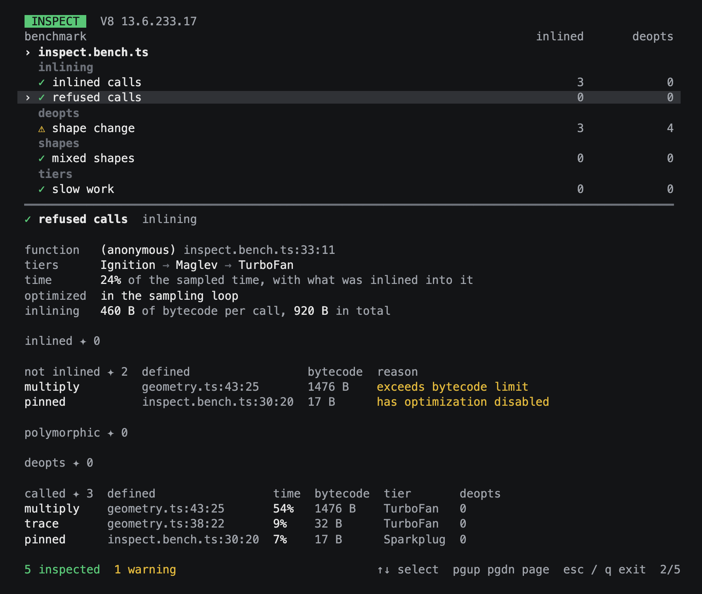
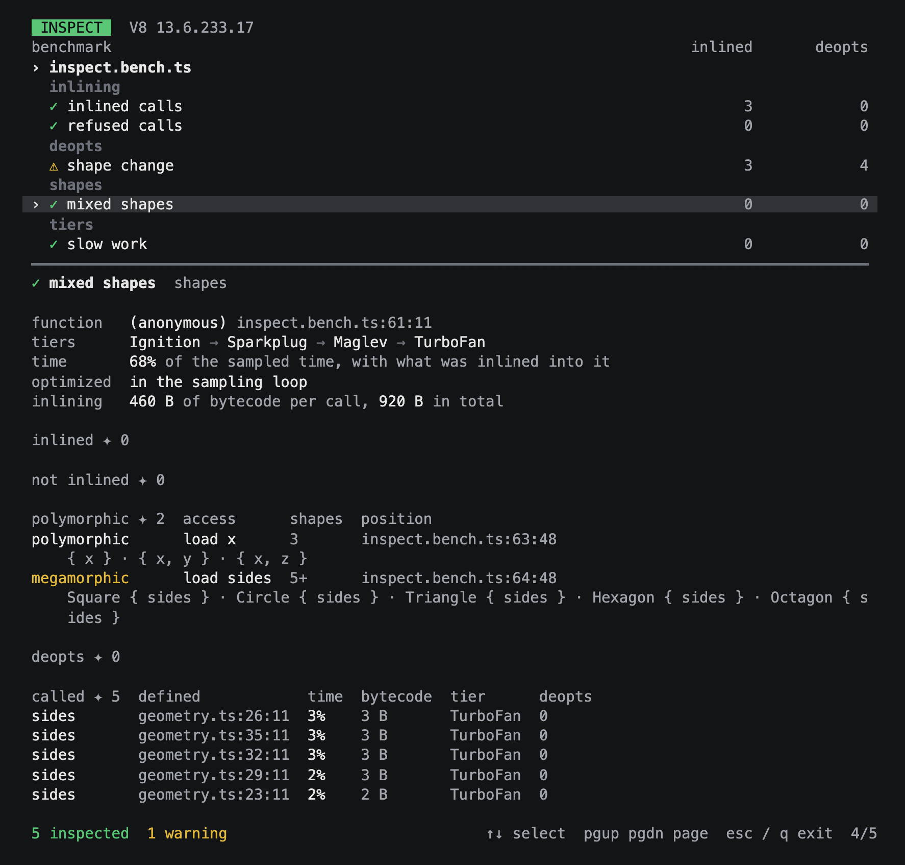

# Inspect example

Five benchmarks that each give `bench inspect` something different to report. The workloads
are small geometry routines written locally in `geometry.ts` with no dependencies.

```sh
pnpm inspect              # open the report
pnpm inspect --bytecode   # also list the bytecode of each workload
pnpm inspect --json       # the same report as JSON on stdout
```

## inlining

- **inlined calls** measures the length of a path. `pathLength` calls `distance`, which calls
  `lengthSq`. All three are small, so the report lists them under `inlined` as a tree, each
  with the position it was called from.
- **refused calls** multiplies two matrices and halves the trace of the result. `multiply` is
  written out in full and is too large to inline, and `pinned` is barred from optimization.
  Both appear under `not inlined` with V8's reason, and under `called` with their share of
  the time.



## deopts

- **shape change** measures the same path, but a point with an extra field arrives a few
  times while the bench runs. The optimized code assumed every point had the same shape, so
  V8 throws it away each time. The bench is marked with the warning a normal run gives it,
  and `deopts` lists each bailout with its reason and its position inside the inlined calls.
  The changes are timed, so how many land in sampling varies from run to run.

## shapes

- **mixed shapes** reads `x` from three kinds of point and calls `sides` on five kinds of
  shape. The report lists both accesses under `polymorphic` with the layouts they saw: the
  first stays polymorphic, and the second is megamorphic because V8 stops tracking shapes
  after four.



## tiers

- **slow work** sorts 4,096 numbers. It is too slow to batch, so Labs calls it once per
  sample and the report shows it `optimized alone` instead of `in the sampling loop`.
